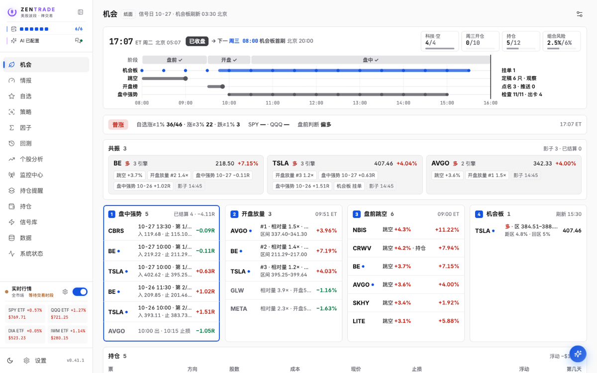
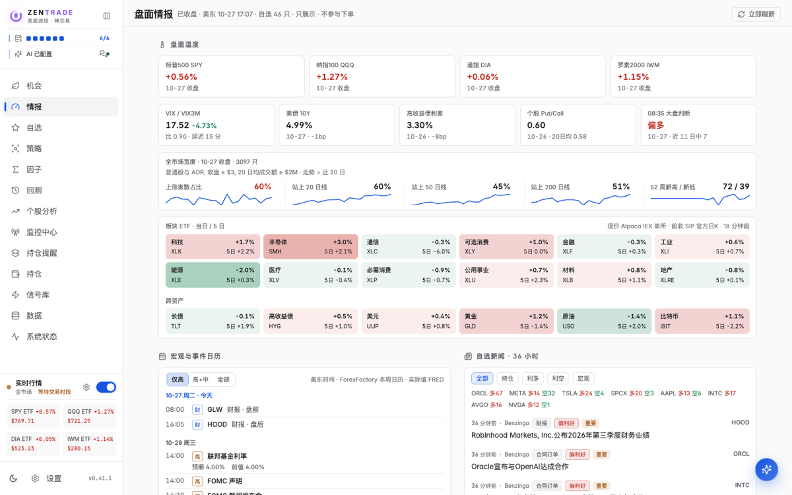
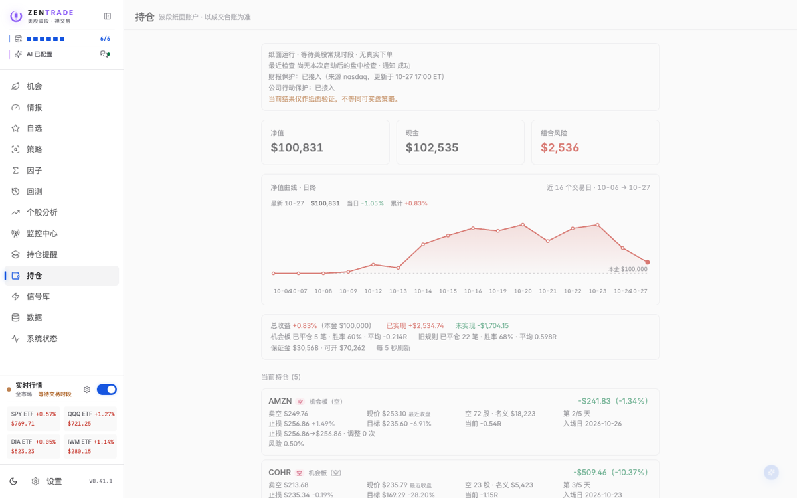
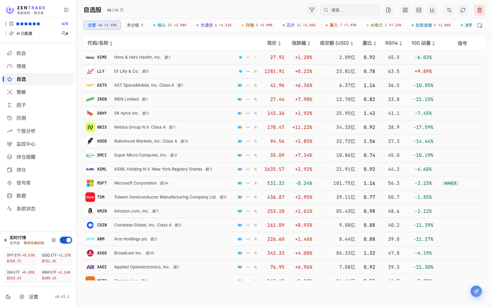
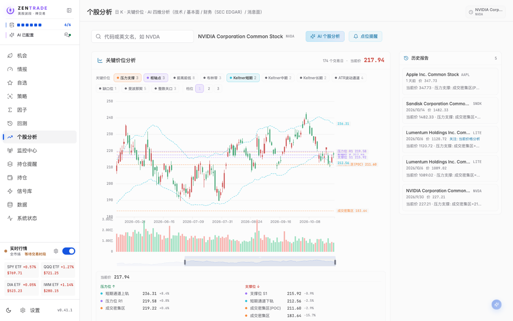
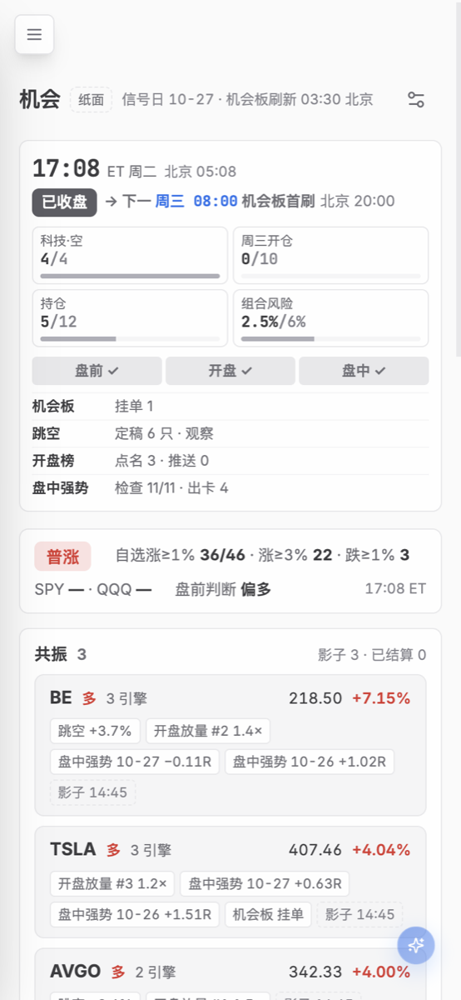
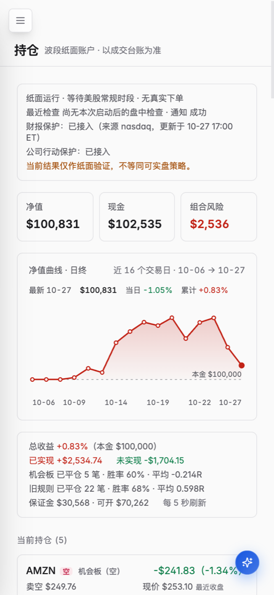

# ZenTrade · 禅交易

[](https://github.com/wuyangfan234/zentrade/actions/workflows/ci.yml)
[](CHANGELOG.md)
[](backend/pyproject.toml)
[](LICENSE)

> A self-hosted research, monitoring and paper-trading workspace for US swing trading.
>
> 自托管的美股波段研究、监控、回测与纸面交易系统。默认持有期不超过 7 个交易日，所有账户结果都来自模拟或纸面数据。

ZenTrade 把分散的研究流程放进同一条可审计链路：从市场数据、策略信号和机会卡，到风险许可、纸面成交、持仓管理与事件台账。每天可以没有机会；每个机会都应带触发区、失效点、目标区和时间边界。

**本项目不连接真实券商下单通道，不构成投资建议。Alpaca 镜像也只使用 paper-api。**



## 核心能力

| 模块 | 能力 |
| --- | --- |
| 机会工作台 | 盘前跳空、开盘放量、盘中强势、波段机会板与跨引擎共振；按美东时段组织信息 |
| 盘面情报 | 核心指数、市场宽度、板块与跨资产热力、宏观和财报日历、自选新闻；只展示，不直接触发交易 |
| 策略研究 | 内置与自定义策略、因子检验、策略挖掘、回测、参数优化和样本外验证 |
| 纸面交易 | 风险预算、入场与退出、仓位管理、公司行动处理、只追加事件台账和净值重放 |
| 数据与扩展 | 数据源能力路由、Python 插件、YAML 自定义 HTTP 数据源、Parquet + DuckDB 本地存储 |
| 运维可观测 | 数据同步、报价、新闻、推送和保护性数据源的健康状态；支持桌面与移动端 |

| 盘面情报 | 纸面持仓 |
| --- | --- |
|  |  |

<details>
<summary>查看更多界面</summary>

| 自选 | 个股分析 |
| --- | --- |
|  |  |

<p>
  
  
</p>

</details>

截图中的账户数字均为纸面数据。

## 默认交易纪律

以下默认值与 `backend/app/ledger/core.py`、`backend/app/services/` 中的当前实现一致；规则集可以在允许范围内覆盖部分参数。

| 约束 | 默认值 |
| --- | --- |
| 纸面初始权益 | $100,000 |
| 单笔计划风险 | 权益的 1% |
| 组合总风险 | 不超过权益的 6% |
| 基础持仓数 | 6；下单簿卡可按风险预算调整 |
| 单日新开风险 | 不超过权益的 5%；同板块同方向不超过 2% |
| 最长持有期 | 7 个交易日 |
| 开盘跳空保护 | 开盘越过触发区 2% 时作废 |
| 财报保护 | 财报前一个交易日禁开；持仓期涉及财报时按事件窗口减仓 |
| 成本模型 | $0.005/股，每笔最低 $1；滑点 5 bps |

## 快速开始

### 环境要求

- Docker 与 Docker Compose
- 一个 [Alpaca](https://alpaca.markets/) 账户及其 API Key；免费账户可用于基础行情，具体权限以 Alpaca 当前套餐为准
- 公网部署时，一个强访问密码和 HTTPS 反向代理或隧道

### 启动

```bash
git clone https://github.com/wuyangfan234/zentrade.git
cd zentrade
cp .env.example .env
chmod 600 .env
```

至少填写：

```ini
ALPACA_API_KEY_ID=your_key_id
ALPACA_API_SECRET_KEY=your_secret_key
AUTH_PASSWORD=replace_with_a_long_random_password
```

然后构建并启动：

```bash
docker compose up -d --build
```

打开 <http://localhost:3018>，按页面向导检查配置，并在「数据」页完成首次同步。运行时数据保存在 `./data`，不会因重新构建镜像而被纳入 Git。

默认只允许本机访问（端口绑定 `127.0.0.1`）。局域网访问在 `.env` 设置 `HOST=0.0.0.0`；公网访问请放在 HTTPS 反向代理或受信隧道之后。中国大陆网络构建可设置 `USE_CN_MIRROR=1`。

完整配置见 [配置规范](docs/configuration.md)，更新、备份、密码重置和老 CPU 兼容见 [部署指南](docs/deployment.md)。

### 可选服务

| 配置 | 用途 | 未配置时 |
| --- | --- | --- |
| `TICKFLOW_API_KEY` | 全市场盘中实时行情 | 使用 Alpaca IEX，覆盖与成交量口径受限 |
| `FINNHUB_API_KEY` | 新闻、财报核对、财务兜底与公司图标 | 对应增强能力减少 |
| `SEC_USER_AGENT` | SEC EDGAR 要求的联系标识 | SEC 财务与公告能力不可用或受限 |
| `QVERIS_API_KEY` | 期权、财报预期与电话会 | 对应付费增强项关闭 |
| `AI_*` | 个股分析、新闻翻译打标与 AI 策略生成 | AI 功能关闭，核心交易环不受影响 |
| 推送配置 | 飞书、企业微信、Webhook 或邮件 | 提醒仅保留在页面内 |

## 本地开发

要求 Python 3.11+、Node.js 20+、pnpm 9 和 [uv](https://docs.astral.sh/uv/)。

```bash
# 后端
cd backend
uv sync --extra dev --frozen
uv run --frozen pytest tests -q

# 前端
cd ../frontend
pnpm install --frozen-lockfile
pnpm test
pnpm build

# 可选：一次执行完整本地门禁
cd ..
bash scripts/gate.sh
```

前后端分开调试可使用 `./dev.sh`（Windows 使用 `dev.ps1`）。贡献规范与数据口径见 [CONTRIBUTING.md](CONTRIBUTING.md)。

## 架构摘要

```text
React / TypeScript UI
        │ HTTP + SSE
FastAPI API
        │
        ├─ 市场时钟：美东交易日、交易时段与持有期
        ├─ 数据能力总线：按数据源声明授予能力，缺失时明确降级
        ├─ 策略引擎：信号、因子、回测与研究候选
        ├─ 机会协议：触发、失效、目标和时间边界
        ├─ 证据许可：区分研究观察、可纸面执行与降级状态
        └─ 交易环 + 事件台账：准入、成交、管理、退出与重放
                 │
          Parquet + DuckDB + 本地 JSON
```

详见 [架构说明](docs/architecture.md)。

## 文档

- [部署指南](docs/deployment.md)
- [配置规范](docs/configuration.md)
- [架构说明](docs/architecture.md)
- [策略指南](docs/strategy.md)
- [因子与策略挖掘](docs/mining.md)
- [数据源插件开发](docs/plugin-development.md)
- [自定义 HTTP 数据源](docs/custom-data-source.md)
- [二次开发](docs/secondary-development.md)
- [维护脚本](backend/scripts/README.md)
- [贡献指南](CONTRIBUTING.md)
- [行为准则](CODE_OF_CONDUCT.md)
- [安全说明](SECURITY.md)
- [第三方声明](THIRD_PARTY_NOTICES.md)
- [更新日志](CHANGELOG.md)

## 安全边界

ZenTrade 是单用户、自托管应用，不是多租户服务。登录后拥有完整控制权；自定义 Python 策略的 AST 校验不是安全沙箱。扩展数据 URL 可能触发服务端请求，因此不要把实例开放给不受信任的人，也不要将 3018 端口直接暴露到公网。默认配置下 CORS 只允许同源，登录 Cookie 在 HTTPS 下自动加 `Secure`。部署前请阅读 [SECURITY.md](SECURITY.md)。

## 许可与归属

- ZenTrade 原创代码以 [MIT License](LICENSE) 发布，但不包括下列第三方组件。
- 项目基于 [TSP (tick-stock-panel)](https://github.com/shy3130/tick-stock-panel) 的 MIT 授权代码演进；上游版权与许可保留在 [LICENSE.upstream](LICENSE.upstream)。
- 部分策略移植保留 GPL-3.0、MPL-2.0、CC BY-NC-SA 4.0、非商用或作者原始声明；这些内容**不适用本项目的 MIT 授权**。
- 严格开源或商业使用前，必须逐项核对 [THIRD_PARTY_NOTICES.md](THIRD_PARTY_NOTICES.md)。含非商用限制的组件不应被理解为 OSI 意义上的全仓统一开源授权。
- 需要只含 OSI 许可内容的版本时，用 `python scripts/export_core.py --out <目录>` 导出开源核心版（清单见 `scripts/core_manifest.toml`）。

## 免责声明

本项目仅供学习、软件研究与量化方法验证。所有回测、信号、净值、收益和胜率均为历史模拟或纸面结果，不代表未来表现，不构成投资建议、证券咨询或交易推荐。第三方数据的准确性和可用性以其提供方为准。使用者须自行遵守适用法律法规、数据源条款和第三方许可，并承担全部使用风险。
