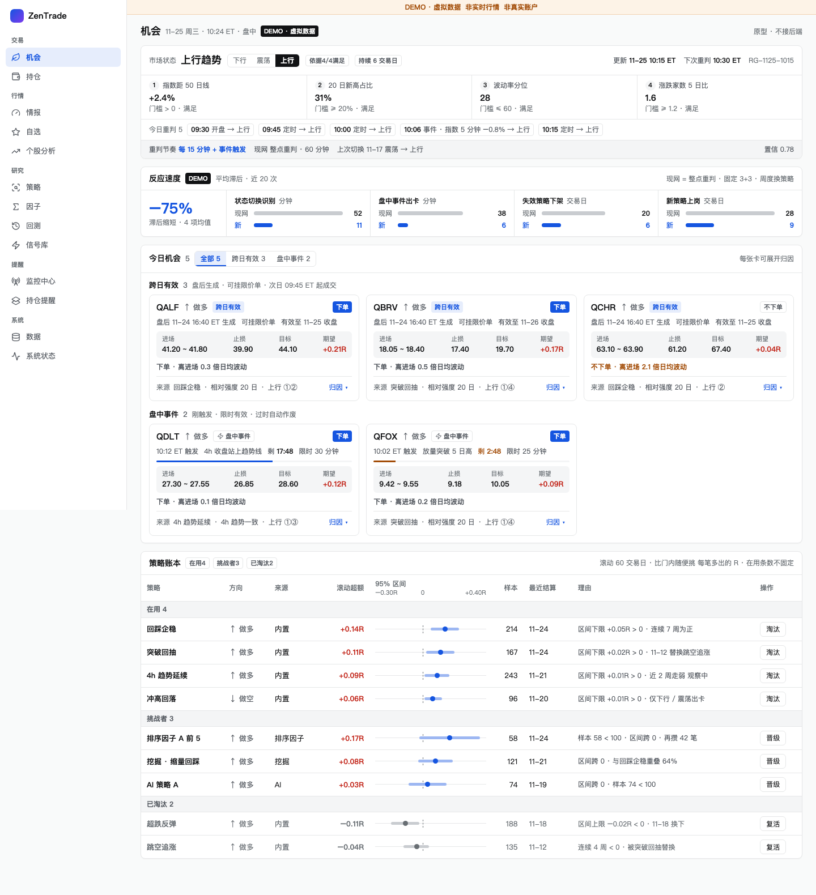
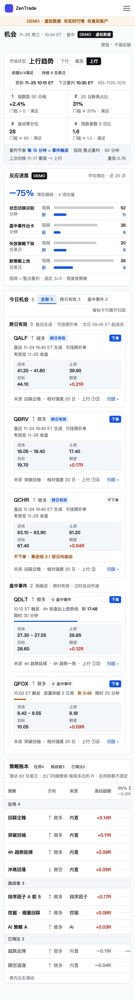
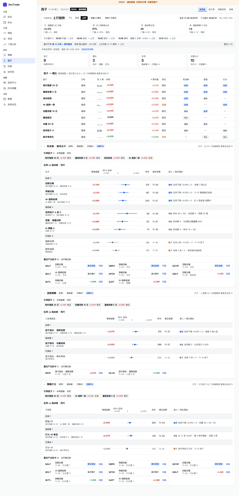
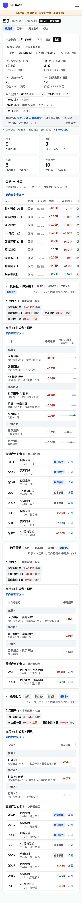
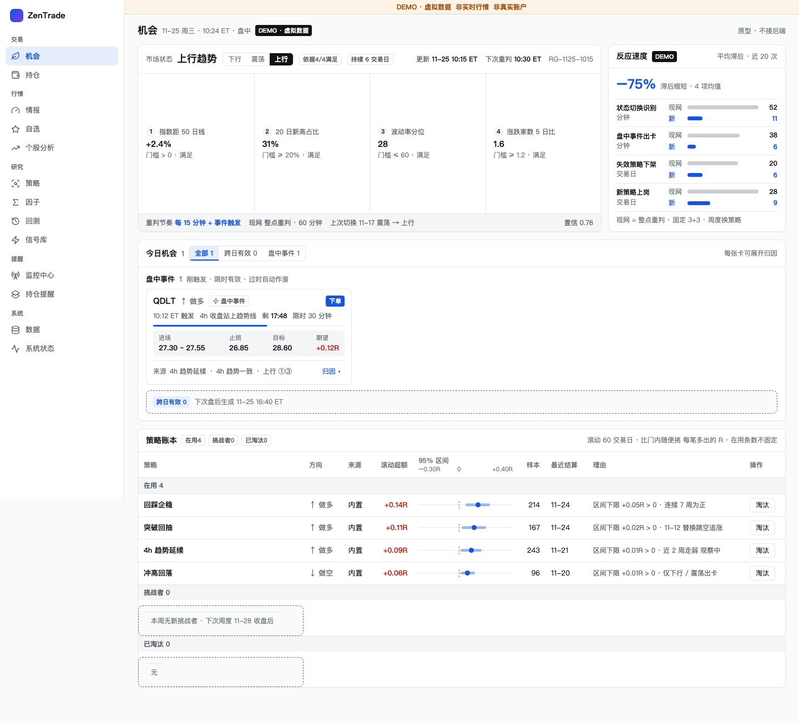
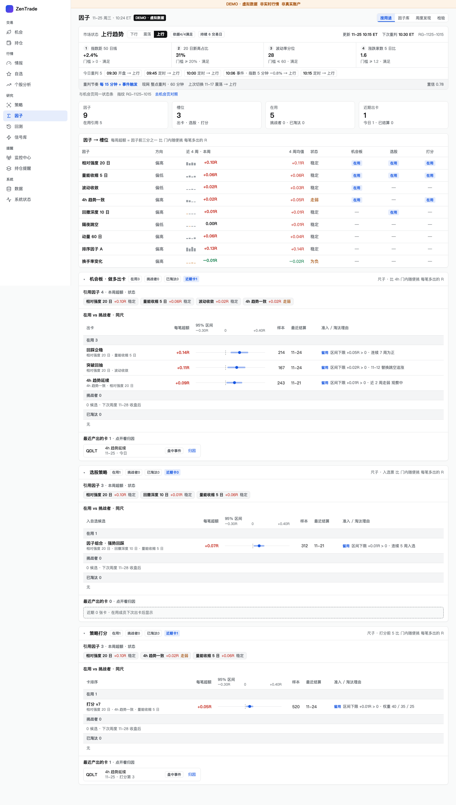

# 机会页 / 因子页新版 · UI 参考稿（DEMO 虚拟数据）

> **全部数字为 DEMO 虚拟数据**：股票代码（QALF、QBRV…）是虚构的，价格、R 值、样本数、时间戳都不是实时行情，也不是真实账户。页面顶部和标题旁都标了「DEMO · 虚拟数据」。
> 这两份稿只用来拍板界面形态，不接后端，也不改任何生产组件。

## 文件

| 文件 | 是什么 |
| --- | --- |
| [opp-next.html](opp-next.html) | 机会页新版：市场状态（regime）条、反应速度对照、今日机会（跨日有效 / 盘中事件 + 倒计时 + 卡归因）、策略账本（在用 / 挑战者 / 已淘汰） |
| [factor-next.html](factor-next.html) | 因子页新版：因子 → 槽位矩阵、三个槽位（机会板做多出卡 / 选股策略 / 策略打分）的引用因子、在用 vs 挑战者同尺对比、准入 / 淘汰理由、最近产出的卡（点开看归因），以及与机会页共用的 regime 条 |
| `src/` | 生成两份 HTML 的源：`shared.css` / `shared.js`（侧栏、regime 条、虚拟数据、归因、抽屉，两页共用同一份）、`opp.*`、`factor.*`、`shell.html` |
| `tools/build.py` | 把 `src/` 拼成两份单文件 HTML（内联 CSS / JS） |
| `tools/mockup_check.py` | zentrade-dev skill 的参考稿自检脚本原样拷贝（JS 报错 / 对比度 / 折行 / 数字截断 / 整句 / 横向溢出） |
| `tools/verify.py` | 在 `mockup_check.py` 之上加计数、互压、出框、文字溢出、同排卡等高与两页 regime 条一致性断言，并截全部状态 |
| `shots/` | 必交 6 张截图；`shots/extra/` 是交互状态的补充截图 |

## 怎么打开

两份 HTML 都是纯静态单文件，双击即可在浏览器打开，不需要服务器。地址参数可直达状态：

| 参数 | 作用 |
| --- | --- |
| `?d=sparse` | 稀疏态：机会页只剩 1 张盘中卡、跨日 0 张、挑战者 / 已淘汰 0；因子页挑战者 0 候选、选股槽位 0 张卡 |
| `?c=c4` | 机会页展开某张卡的归因 |
| `?f=x` / `?f=i` | 机会页只看跨日有效 / 盘中事件 |
| `?x=all` | 因子页三个槽位全部展开（默认只展开机会板） |
| `?open=r1` | 因子页打开某张卡的归因抽屉 |

## 机制与页面位置

| 方案机制 | 页面位置 |
| --- | --- |
| 1 市场状态 regime 条 | 两页顶部同一张卡：当前状态、4 项判定依据（门槛 + 是否满足）、更新时间、下次重判、今日重判记录（15 分钟定时 + 事件触发，现网整点 60 分钟）、状态指纹 `RG-1125-1015` |
| 2 策略账本 | 机会页「策略账本」：在用 4 / 挑战者 3 / 已淘汰 2（在用条数不固定），每行滚动超额 R、95% 区间横条（全表同一刻度）、样本、最近结算、理由、淘汰 / 晋级 / 复活按钮（静态） |
| 3 出卡时效 | 机会页卡片分两组：「跨日有效」（盘后生成、可挂限价单、有效至某日收盘）与「盘中事件」（触发时刻 + 事件 + 秒级倒计时，剩 5 分钟内转琥珀色） |
| 4 卡归因 | 每张卡底部一行来源（策略 · 因子 · 状态依据编号），点「归因」展开策略层级与成绩、因子取值与门槛、本卡用到的 regime 依据、打分排名、时效 |
| 5 反应速度对照 | 机会页「反应速度 DEMO」：现网 vs 新的平均滞后（状态切换识别、盘中事件出卡、失效策略下架、新策略上岗），按单位分组同一刻度画条 |
| 因子 → 槽位 → 卡闭环 | 因子页矩阵 + 每个槽位展开后的「引用因子」「在用 vs 挑战者 · 同尺」「最近产出的卡」；卡点开就是和机会页同一个归因组件 |
| 同尺对比 | 尺子沿用 FactorSlots 语义：比「门内随便挑」每笔多出的 R，三个槽位的区间横条用同一刻度 −0.30R ~ +0.40R |

## 截图怎么生成

截图由真浏览器渲染（Playwright Chromium headless），不是手绘：

```bash
python3 docs/prototype/tools/build.py                 # 改了 src/ 之后重新生成两份 HTML
pip install playwright && playwright install chromium # 只需一次
python docs/prototype/tools/verify.py                 # 自检全部状态并重截 shots/
```

`verify.py` 逐个状态打开页面，跑完全部检查后截整页（抽屉状态按抽屉内容高度截），任一项有问题退出码为 1。桌面视口 1440×900，手机视口 390×844（2 倍像素）。

| 截图 | 状态 |
| --- | --- |
|  | `shots/opp-desktop.png` 机会页 · 1440 桌面 · 填满 |
|  | `shots/opp-mobile.png` 机会页 · 390 手机 · 填满 |
|  | `shots/factor-desktop.png` 因子页 · 1440 桌面 · 三槽位展开 |
|  | `shots/factor-mobile.png` 因子页 · 390 手机 · 三槽位展开 |
|  | `shots/opp-sparse.png` 机会页稀疏态 · 单卡 / 跨日 0 / 挑战者 0 |
|  | `shots/factor-sparse.png` 因子页稀疏态 · 0 候选 / 单卡 |

补充状态（`shots/extra/`）：归因展开、只看盘中事件、因子页归因抽屉（桌面 / 手机）、槽位收起、两页稀疏态手机版。

## 自检项（全部为 0 才算过）

- JS 报错、对比度（WCAG AA）、按钮折行、数字截断、整句与禁用词、横向溢出（`mockup_check.py`）
- 计数一致：页面上每个计数（`data-count`）等于实际列出的行 / 卡（`data-item`），筛选后显示数等于可见卡数
- 同行兄弟元素互压、卡内元素越出卡片、文字溢出自身格子、同排卡等高
- 两页 regime 条文本逐字一致（同一状态、同一时间戳、同一指纹）
- 页面含「DEMO · 虚拟数据」标注
