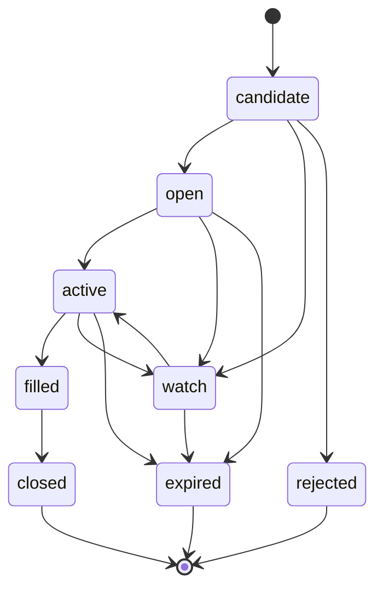
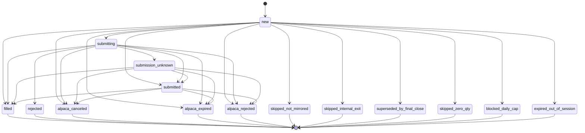
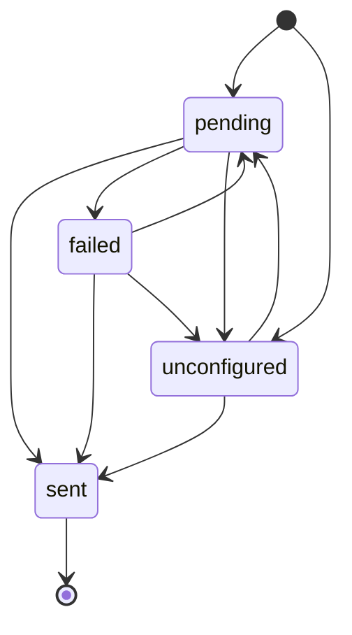
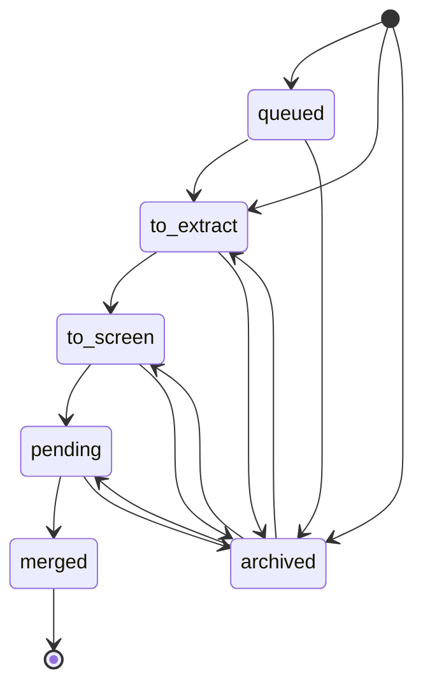
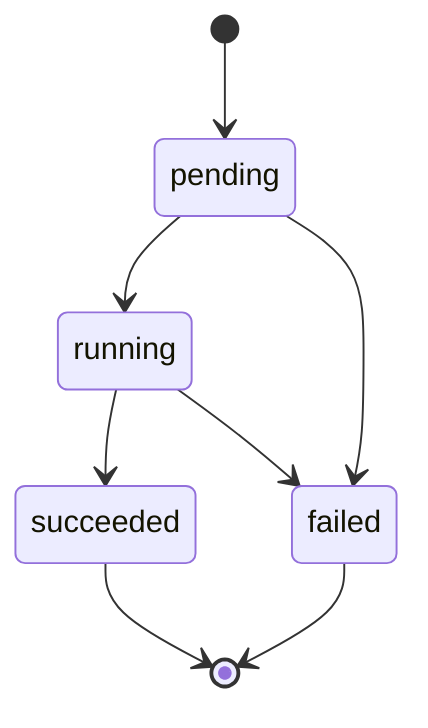
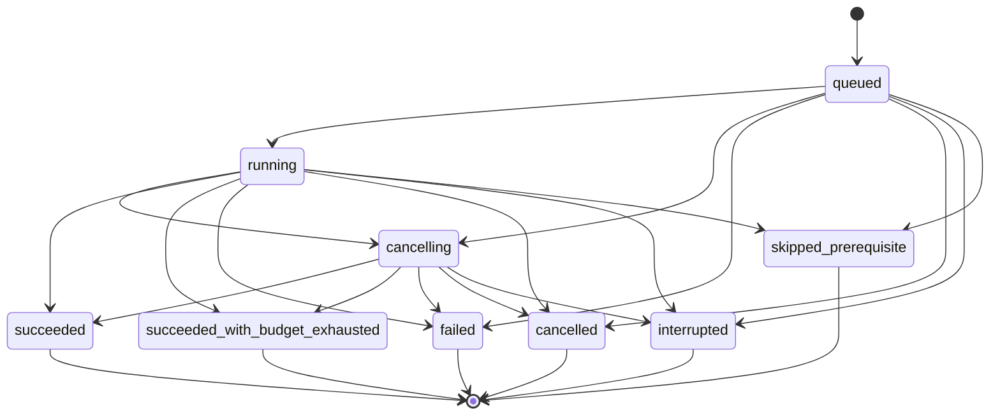

# 状态机一览

<!-- 本文件由 scripts/gen_lifecycles.py 生成, 不要手改。改状态请改 backend/app/lifecycles.py 后重新生成。 -->

系统里会落盘、跨进程或跨前后端传递的状态都登记在 `backend/app/lifecycles.py`。这份文档、
`GET /api/lifecycles` 接口和前端的中文状态名都从那一份登记表生成。

- **新增或改名状态**：改 `backend/app/lifecycles.py` → `backend/.venv/bin/python scripts/gen_lifecycles.py` → 提交生成物。
  属主模块写出登记表之外的状态时，`backend/tests/test_lifecycles.py` 会失败。
- **登记不等于拦截**：标「只登记」的状态机仍由属主模块自己推进，登记表不改变它的行为；
  机会卡的转换另有一道只记日志的核对（表外转换写一条 warning，不拦截）。
- **读状态的中文名**：后端 `lifecycles.label(id, code)`，前端 `lifecycleLabel(id, code)`。

## 机会卡（`opportunity_card`）

- 属主：`backend/app/services/opportunity_service.py`，字段 `state`
- 落盘：`ledger/events.jsonl (opportunity / fill / close 事件重放得出)`
- 表外转换：只登记，不拦截

| 代码 | 中文名 | 终态 | 说明 |
| --- | --- | --- | --- |
| `candidate` | 初筛候选 |  | 管线初筛产出, 尚未过组合约束 |
| `open` | 待入场 |  | 通过组合约束, 等下一交易日开盘确认 |
| `active` | 监控中 |  | 开盘确认有效, 价格进入场区即可成交 |
| `watch` | 观察 |  | 准入或组合约束拦下, 只展示不开仓; 容量恢复且价在区内可回到监控中 |
| `filled` | 已入场 |  | 纸面成交, 移交交易员管理 |
| `closed` | 已平仓 | 是 |  |
| `expired` | 已失效 | 是 | 入场窗结束 / 跳空越过 / 盘前越止损 / 除权后价位失效 |
| `rejected` | 已否决 | 是 | 评估否决 |

## Alpaca 模拟镜像订单（`mirror_order`）

- 属主：`backend/app/services/alpaca_mirror.py`，字段 `status`
- 落盘：`alpaca_mirror/state.json (orders)`
- 表外转换：只登记，不拦截

| 代码 | 中文名 | 终态 | 说明 |
| --- | --- | --- | --- |
| `new` | 待提交 |  | 台账成交已登记, 还没发给 Alpaca |
| `submitting` | 提交中 |  | 发单前先落盘的围栏; 进程在发单途中死掉也只按订单号对账, 不重发 |
| `submission_unknown` | 提交结果待确认 |  | 发单超时或 5xx, 不知道 Alpaca 收没收到; 只对账不重发 |
| `submitted` | 已提交 |  | Alpaca 已受理, 等成交 |
| `filled` | 已成交 | 是 |  |
| `rejected` | 被拒 | 是 | 发单时 Alpaca 明确拒绝 (4xx) |
| `alpaca_canceled` | Alpaca 已撤单 | 是 |  |
| `alpaca_expired` | Alpaca 已过期 | 是 |  |
| `alpaca_rejected` | Alpaca 拒单 | 是 | 受理后被 Alpaca 拒绝 |
| `skipped_not_mirrored` | 未镜像（开启前的持仓） | 是 |  |
| `skipped_internal_exit` | 未提交（内部已平仓） | 是 | 开仓单还没发出, 内部这一轮已经平仓 |
| `superseded_by_final_close` | 已并入全平 | 是 | 减仓单还没发出, 后面的全平单一并处理 |
| `skipped_zero_qty` | 数量为 0 | 是 |  |
| `blocked_daily_cap` | 超过每日上限 | 是 | 只拦开仓单; 平仓单等到次日不作废 |
| `expired_out_of_session` | 超时未提交 | 是 | 开仓单错过交易时段或提交窗口 |

## 通知发件箱（`notification_outbox`）

- 属主：`backend/app/services/notification_outbox.py`，字段 `status`
- 落盘：`notifications/outbox.sqlite3 (表 outbox)`
- 表外转换：只登记，不拦截

| 代码 | 中文名 | 终态 | 说明 |
| --- | --- | --- | --- |
| `pending` | 待发送 |  | 已入队, 等下一次投递 |
| `unconfigured` | 未配置 |  | 没有可用渠道; 配好后自动回到待发送 |
| `failed` | 失败 |  | 本次投递有渠道失败; 退避后重试, 最多 5 次, 耗尽后停在这里 |
| `sent` | 成功 | 是 | 勾选的渠道全部受理 |

## 因子采集条目（`factor_intake_item`）

- 属主：`backend/app/services/factor_intake.py`，字段 `stage`
- 落盘：`research/intake/items.json`
- 表外转换：只登记，不拦截

| 代码 | 中文名 | 终态 | 说明 |
| --- | --- | --- | --- |
| `queued` | 排队中 |  | 过了预筛, 等模型判断是否值得提取 |
| `to_extract` | 排队中 |  | 等模型提取公式 |
| `to_screen` | 快筛中 |  | 公式已提取, 等数据快筛 |
| `pending` | 待审 |  | 快筛完成, 等用户并入或忽略 |
| `merged` | 已并入 | 是 | 已进因子库 (观察) |
| `archived` | 已归档 |  | 预筛丢弃 / 失败 / 重复 / 已忽略; 可恢复或重试 |

## 数据同步任务（`pipeline_job`）

- 属主：`backend/app/services/pipeline_jobs.py`，字段 `status`
- 落盘：`job_store/<id>.json`
- 表外转换：只登记，不拦截

| 代码 | 中文名 | 终态 | 说明 |
| --- | --- | --- | --- |
| `pending` | 排队中 |  |  |
| `running` | 运行中 |  |  |
| `succeeded` | 已完成 | 是 |  |
| `failed` | 失败 | 是 | 出错 / 取消 / 排队超时 / 后端重启时补录 |

## 因子挖掘任务（`mining_run`）

- 属主：`backend/app/services/mining_jobs.py`，字段 `status`
- 落盘：`research/mining/runs/<run_id>/`
- 表外转换：属主模块直接拒绝

| 代码 | 中文名 | 终态 | 说明 |
| --- | --- | --- | --- |
| `queued` | 排队中 |  |  |
| `running` | 运行中 |  |  |
| `cancelling` | 取消中 |  |  |
| `succeeded` | 已完成 | 是 |  |
| `succeeded_with_budget_exhausted` | 已完成（预算用尽） | 是 |  |
| `failed` | 失败 | 是 |  |
| `cancelled` | 已取消 | 是 |  |
| `interrupted` | 被中断 | 是 |  |
| `skipped_prerequisite` | 前置条件不足 · 已跳过 | 是 |  |

## 没有登记的状态

下面这些也是状态，但都是从别的数据当场算出来的，或者只活在一个页面里，不落盘、没有「转换」可言，所以不进登记表。
改它们时直接看属主文件。

| 状态 | 取值 | 属主 |
| --- | --- | --- |
| 交易时段 | `closed` `night` `premarket` `open_wait` `session` `after` | `backend/app/services/card_volume.py::phase` |
| 机会板卡结局（回放） | `pending` `holding` `closed` `no_fill` `void` `invalid` | `backend/app/services/swing_settlement.py` |
| 规则回放结局 | `pending` `triggered` `closed` `expired` `gap_expired` | `backend/app/services/card_replay.py` |
| 盘中强势卡 | `open` `closed` `void` | `backend/app/services/intraday_strength.py` |
| 入场意图 | `pending` `blocked` | `backend/app/trader/trader.py`（台账 `entry_intent` 事件） |
| 因子成熟度 | `experiment` `observing` `active` `retired` | `backend/app/services/factor_maturity.py::state_at` |
| 模型对照结论 | `none` `running` `promoted` `rejected` | `backend/app/services/ls_model.py` |
| 研究候选 | `pending` `validated` `rejected` | `backend/app/backtest/candidates.py` |
| 更新检查 | `idle` `checking` `latest` `found` `error` `disabled` | `frontend/src/lib/updateCheck.ts` |
| 行情推送连接 | `connected` `reconnecting` `disconnected` | `frontend/src/lib/useQuoteStream.ts` |
| 个股分析弹窗 | `loading` `streaming` `done` `error` | `frontend/src/lib/stockAnalysisStore.ts` |
| 侧栏 | `expanded` `rail` `hidden` | `frontend/src/components/Layout.tsx` |
